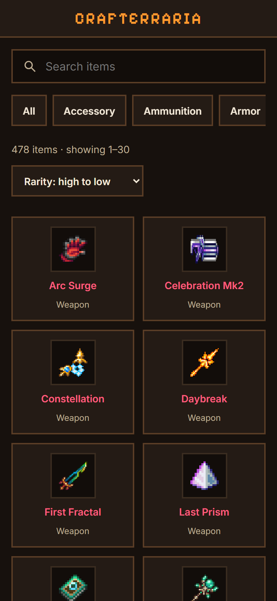
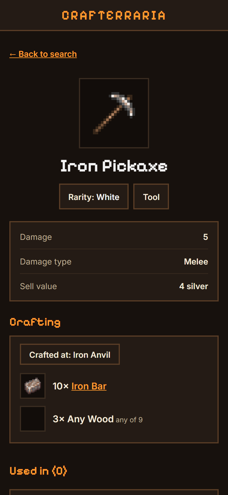
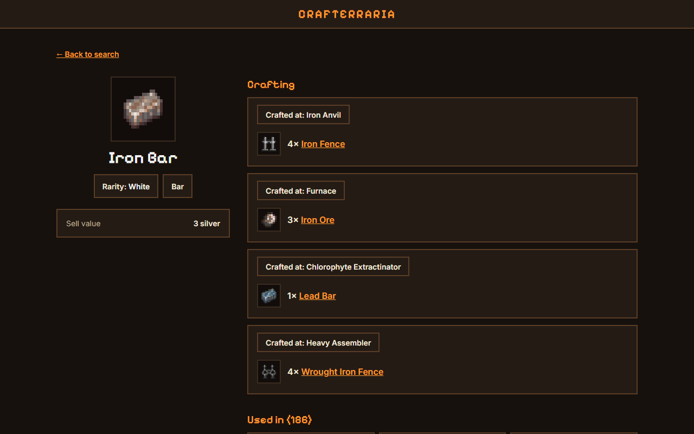
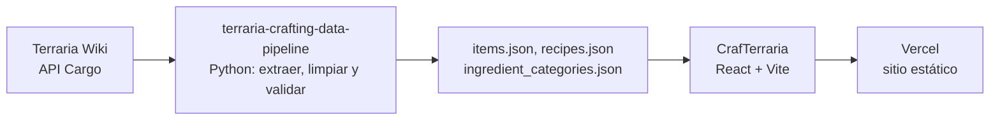

# CrafTerraria

[](https://github.com/Ren-reno/CrafTerraria/actions/workflows/ci.yml)
[](https://craf-terraria.vercel.app/)
[](./LICENSE)


**Buscador de recetas de crafteo de Terraria.** Busca un ítem y mira con qué se fabrica, en qué estación y para qué sirve. Interfaz en inglés, responsive (móvil y desktop) y sin backend: funciona con datos que extraje y validé yo mismo con un [pipeline propio](https://github.com/Ren-reno/terraria-crafting-data-pipeline).

### 🔗 [Ver la demo](https://craf-terraria.vercel.app/)

## Capturas

<p>
  
  
  
</p>

## Qué hace

- **Búsqueda por nombre**, ordenada por mejor coincidencia (exacta, por prefijo, por palabra, por subcadena).
- **Listado completo** con filtro por categoría, orden por nombre, rareza o daño (el daño solo aparece en categorías donde aplica) y paginación clásica de 30 ítems.
- **Detalle de cada ítem:** rareza con su color, estadísticas (daño, defensa, valor de venta en monedas del juego), recetas con su estación de crafteo y condición, ingredientes enlazados entre sí y una sección "Used in" con todas las recetas donde participa.
- **Ingredientes de grupo** como "Any Wood": se despliegan para ver qué ítems acepta la receta.
- **Casos reales de los datos** resueltos en la interfaz: ítems sin receta, ítems que la wiki no tiene en su tabla de ítems y rarezas especiales.
- **URLs compartibles:** la búsqueda, la categoría, el orden y la página viven en la URL (`/?q=iron&category=tool&sort=rarity-desc&page=2`) y el botón atrás funciona.
- **Mobile-first y responsive:** el mismo código y las mismas rutas en móvil, tablet y desktop.

## Los datos: mi propio pipeline

No usé un dataset de terceros: los datasets públicos que encontré estaban desactualizados, así que construí un pipeline en Python que extrae el catálogo completo desde la [Official Terraria Wiki](https://terraria.wiki.gg/) (API Cargo), lo limpia, lo valida con tests y publica los JSON que consume esta app.



Hoy son **6.141 ítems y 3.942 recetas** (extracción del 15 de octubre de 2026). Los problemas de la fuente que el pipeline resuelve, y que la app aprovecha:

| Problema en la wiki | Qué hace el pipeline | Cómo lo usa la app |
|---|---|---|
| 12 `itemId` repetidos | Conserva la primera aparición y deja un reporte | Ids únicos como clave de rutas y listas |
| 45 ítems con receta pero sin ficha | Recupera el nombre desde la receta y confirma por HTTP que la imagen existe | Se muestran y se pueden buscar como cualquier ítem |
| Ingredientes tipo "Any Iron Bar" | Los modela como grupos con sus miembros | Ingredientes desplegables |
| Ids de receta que cambiaban en cada extracción | Ids estables `{resultItemId}-{n}`, calculados por contenido | Se pueden usar como clave sin romperse entre actualizaciones |
| Datos que cambian con cada parche del juego | 36 tests de calidad de datos, con límites de tolerancia | La app repite un chequeo de coherencia y falla si el JSON copiado está roto |

La app incluye una copia de los datos, fijada a un commit concreto del pipeline (ver [`src/data/README.md`](./src/data/README.md), que también explica cómo actualizarla).

## Stack

| Tecnología | Uso |
|---|---|
| React 19 + Vite 7 | Interfaz y build |
| React Router 7 | Rutas por ítem y estado de la búsqueda en la URL |
| CSS con variables | Tema propio (paleta, rarezas, breakpoints), sin framework de estilos |
| `@fontsource` | Inter y Pixelify Sans autoalojadas, sin depender de Google Fonts |
| Vitest + Testing Library | 95 pruebas de la capa de datos y de las pantallas |
| GitHub Actions | CI en cada push, con Node 20.19, 22 y 24 |
| Vercel | Hosting estático gratuito, con despliegue automático desde `main` |

## Decisiones técnicas

- **Sin backend.** Los datos viajan dentro del JavaScript (unos 2 MB, 255 KB comprimidos), así que no hay servidor que mantener ni pagar. Si el catálogo crece, el siguiente paso sería dividir el código.
- **Una sola capa de acceso a datos** (`src/services/dataService.js`). Ningún componente importa los JSON: todo pasa por funciones con índices en memoria, y toda la lógica de búsqueda, orden y "usado en" se prueba sin pantallas.
- **Estado en la URL** en vez de en memoria: cada vista se puede compartir, y los valores inválidos (categoría inexistente, página mal escrita) se ignoran en vez de romper la pantalla.
- **Imágenes enlazadas desde la wiki, no copiadas.** Los íconos son arte de Re-Logic, así que el repositorio no los redistribuye. Cada imagen tiene carga diferida e ícono de respaldo si falla (ya hay casos reales de URLs rotas en la fuente).
- **Reglas de orden explícitas y probadas.** Al ordenar por rareza, los tiers especiales (Quest, Rainbow, Fiery Red) y los ítems sin rareza quedan siempre al final, en ambos sentidos.
- **Accesibilidad básica medida, no supuesta:** contraste AA en todos los colores del tema (mínimo 5,7:1), botones y chips de al menos 44 px de alto, foco visible y elementos HTML nativos (enlaces, botones, `select`, `details`).
- **Pruebas que de verdad detectan errores.** Se validaron introduciendo fallos a propósito (por ejemplo, un error de una unidad en la paginación) y comprobando que alguna prueba los atrapa.

## Cómo correrlo

Requisitos: **Node 20.19 o superior** (o 22.12+, o 24) y npm.

```bash
git clone https://github.com/Ren-reno/CrafTerraria.git
cd CrafTerraria
npm install
npm run dev      # servidor de desarrollo
npm test         # 95 pruebas
npm run build    # build de producción en dist/
```

```
src/data/        copias de items.json, recipes.json e ingredient_categories.json
src/services/    dataService.js: único punto de acceso a los datos
src/components/  ItemCard, ItemSlot, ItemName, ItemImage, RarityBadge, SearchBox, Pagination
src/lib/         rarity.js, format.js (precios en monedas) y paginate.js
src/styles/      tokens.css: paleta y colores de rareza
src/pages/       Home, ItemDetail, CategoryView (redirección), NotFound
```

## Publicación

Es un sitio estático: `npm run build` genera `dist/` y Vercel lo publica en cada push a `main`. `vercel.json` hace que un enlace directo como `/item/1` abra la app en vez de dar un 404.

## Documentación

El diseño, los requisitos y el registro de decisiones están en [`docs/01-definicion-y-requisitos.md`](./docs/01-definicion-y-requisitos.md).

## Atribución y licencia

Los datos provienen de la [Official Terraria Wiki](https://terraria.wiki.gg/) y se distribuyen bajo CC BY-NC-SA 4.0, según se detalla en el [`ATTRIBUTION.md`](https://github.com/Ren-reno/terraria-crafting-data-pipeline/blob/main/ATTRIBUTION.md) del repositorio de datos. Los íconos de ítems se cargan directamente desde la wiki y no se almacenan en este repositorio. Terraria es propiedad de Re-Logic; este es un proyecto no oficial, hecho por fans y **sin fines comerciales**: por eso el sitio no lleva publicidad, donaciones ni cobros.

El código se distribuye bajo licencia MIT (ver [`LICENSE`](./LICENSE)). Los datos y las imágenes tienen sus propias licencias, descritas arriba.
